<div align="center">



# M. Zikri Al-Bukhori

**Front-End Developer & UI Designer — Medan, Indonesia**

*Mengubah ide jadi pengalaman web yang interaktif, dinamis, dan berkesan.*

[](https://trynvexa.github.io)
[](https://github.com/trynvexa)
[](https://wa.me/6281367381826)

</div>

---

## ✦ Tentang Proyek

<table>
<tr>
<td width="50%">

**Portofolio interaktif** yang dibangun sepenuhnya dengan teknologi web native — tanpa framework, tanpa build step, tanpa dependensi NPM. Setiap halaman dirancang sebagai *panggung* tersendiri dengan pengalaman visual yang imersif.

</td>
<td width="50%">

| | |
|---|---|
| 📄 **Halaman** | 8 scene interaktif |
| 🌍 **Bahasa** | 8 bahasa + RTL |
| 📦 **Dependencies** | 0 npm packages |
| ⚙️ **Build Step** | Tidak diperlukan |
| 🏠 **Hosting** | GitHub Pages |
| 📱 **Responsive** | Mobile-first |

</td>
</tr>
</table>

---

## 🎪 Galeri Halaman

<div align="center">

| Halaman | Deskripsi |
|:---:|:---|
| 🃏 **Roda Kartu Radial** | Navigasi 8 kartu 3D dengan koreografi *Cardistry Deal & Flip*, serpihan kaca, dan spring physics |
| 💻 **Me — Laptop Dive** | Potret cutout + lanyard 3D, transisi video masuk ke dalam layar laptop |
| 🏗️ **Zikri's Depot** | Panggung Three.js: 7 kontainer kargo + gantry crane berfisika nyata (angkat, ayun, buka pintu 122°) |
| 🧥 **Fashion Runway** | Lookbook 3D interaktif, 6 koleksi pribadi, tampilan editorial |
| 🎵 **Music** | Vinyl turntable 3D + tonearm bergerak + ring frekuensi audio WebGL real-time |
| ⚛️ **Skill Orbit** | Konstelasi 15 teknologi yang dapat diputar di atas tangan + gyroscope WebGL |
| 🖼️ **Frame Gallery** | Cincin foto 3D, viewfinder HUD, editorial grid, fullscreen lightbox |
| 🧵 **Story** | Garis waktu benang merah 3D — 6 bab perjalanan hidup |
| 🪪 **Kontak** | Kartu identitas holografik prismatik 3D, Quick Inquiry Composer |

</div>

---

## ⚡ Tech Stack

<div align="center">


</div>

**Core APIs yang dipakai:**
- `CSS 3D Transforms` + `Custom Properties` + `View Transitions API`
- `Three.js` untuk semua adegan WebGL (Music, Skill, Depot, Runway)
- `Web Audio API` untuk visualizer frekuensi real-time
- `Web Animations API` untuk koreografi fisika kartu
- `SVG Filters` untuk efek maskot & intro

---

## 📁 Struktur Proyek

```
my-portofolio/
├── index.html              ← markup utama, 8 kartu, SEO/JSON-LD
├── css/
│   ├── theme.css           ← token warna, light/dark, 3D cardistry
│   ├── motion3d.css        ← view transition wipe, tilt, sparks, foil
│   ├── layout.css          ← grid responsif, buddy, galeri, orbit
│   ├── base.css            ← reset, variabel, header, intro
│   ├── pages.css           ← story, music, kontak, mobile polish
│   ├── skills.css          ← skill orbit & gyroscope
│   └── runway.css          ← 3D fashion runway
├── js/
│   ├── carousel.js         ← roda kartu radial 8 kartu + cardistry
│   ├── webgl-scenes.js     ← Three.js: music vinyl + skill orbit
│   ├── projects-depot.js   ← Three.js: container crane (p5)
│   ├── runway.js           ← Three.js: fashion runway (p7)
│   ├── contact.js          ← dev pass 3D + quick composer (p6)
│   ├── page-enhancers.js   ← koreografi 3D per halaman
│   ├── motion3d.js         ← GPU tier detect, tilt 3D, sparks
│   ├── gallery.js          ← frame gallery + lightbox (p3)
│   ├── skills.js           ← orbit 15 tech + modal (p4)
│   ├── story.js            ← garis waktu benang merah (p0)
│   ├── buddy.js            ← mascot physics & jump
│   ├── i18n.js             ← 8 bahasa + RTL Arab
│   └── ...                 ← intro, theme, clock, music, me-dive
└── assets/
    ├── images/             ← portrait, kartu, galeri, preview
    ├── icons/              ← 15 ikon tech (.webp)
    ├── audio/              ← 6 track MP3 (lagu-1 s/d lagu-6)
    ├── me/                 ← aset laptop dive
    └── runway/             ← koleksi fashion (.webp)
```

---

## 🌍 Multi-Language Support

Mendukung **8 bahasa** dengan terjemahan penuh tanpa celah:

<div align="center">

| 🇮🇩 Bahasa Indonesia | 🇬🇧 English | 🇨🇳 中文 | 🇪🇸 Español |
|:---:|:---:|:---:|:---:|
| **🇸🇦 العربية** (RTL) | **🇫🇷 Français** | **🇯🇵 日本語** | **🇰🇷 한국어** |

</div>

Termasuk dukungan **RTL layout** penuh untuk bahasa Arab, dan **jam Medan real-time (WIB)** di header.

---

## 🤸 Fitur Interaksi Spesial

- **Mascot Buddy** — duduk di atas tipografi 3D `PORTOFOLIO`, melompat antar-huruf saat diklik, bereaksi terhadap kartu aktif
- **Tema Dinamis** — Mode terang (*Warm Editorial Paper*) & gelap (*Deep Obsidian*) dengan **circular wipe** View Transition dari titik klik
- **Spring-Damped Tilt** — Setiap kartu merespons gerakan mouse dengan fisika tilt 3D natural
- **Efek Serpihan Kaca** — Animasi fragmentasi saat membuka halaman

---

## 🚀 Jalankan Lokal

Karena ini **murni static** (tanpa build step), cukup:

```bash
# Clone repo
git clone https://github.com/trynvexa/trynvexa.github.io.git
cd trynvexa.github.io

# Jalankan server lokal (pilih salah satu)
python3 -m http.server 8080
# atau
npx serve .
# atau buka langsung index.html di browser
```

Lalu buka **`http://localhost:8080`** di browser.

> ⚠️ Beberapa fitur (Web Audio, WebGL) butuh server lokal — tidak bisa dibuka via `file://` langsung.

---

## 📬 Kontak

<div align="center">

> Terbuka untuk **peluang freelance**, **kolaborasi proyek**, dan **diskusi kreatif.**
> Respons dalam waktu **< 24 jam** via WhatsApp atau Email.

</div>

<br/>

<table align="center">
<tr>
  <td align="center" width="160">
    <a href="https://wa.me/6281367381826">
      <br/>
      <sub><b>+62 813-6738-1826</b></sub>
    </a>
  </td>
  <td align="center" width="160">
    <a href="mailto:zikriganteng2023@gmail.com">
      <br/>
      <sub><b>zikriganteng2023@gmail.com</b></sub>
    </a>
  </td>
  <td align="center" width="160">
    <a href="https://github.com/trynvexa">
      <br/>
      <sub><b>@trynvexa</b></sub>
    </a>
  </td>
  <td align="center" width="160">
    <a href="https://www.instagram.com/yo144484/">
      <br/>
      <sub><b>@yo144484</b></sub>
    </a>
  </td>
  <td align="center" width="160">
    <a href="https://www.tiktok.com/@frince_nael7">
      <br/>
      <sub><b>@frince_nael7</b></sub>
    </a>
  </td>
</tr>
</table>

---

<div align="center">

**© 2026 M. Zikri Al-Bukhori** — Built with ❤️ in Medan, Indonesia

*"Setiap piksel punya cerita."*

</div>
